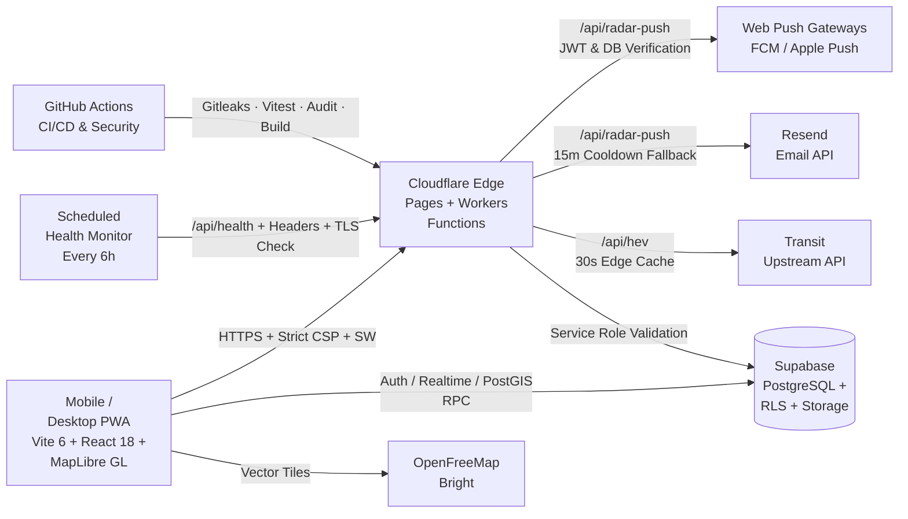

# Kaláka Szentendre — Production Community PWA

[](https://github.com/Markosz008/kalaka/actions/workflows/ci-security-tests.yml)
[](https://github.com/Markosz008/kalaka/actions/workflows/ci-cd.yml)
[](https://github.com/Markosz008/kalaka/actions/workflows/health-monitor.yml)

**Live Production URL:** [https://kalakazz.hu](https://kalakazz.hu)

A live, invite-gated hyperlocal Progressive Web App for Szentendre (~28k residents) combining neighborhood ride-sharing, local favors, crowdsourced traffic/transit alerts (Route 11 & H5 HÉV), and a local service provider directory. Designed, hardened, and operated end-to-end with **$0/month** fixed infrastructure cost.

## Architecture Overview



## DevOps & DevSecOps Highlights

### 1. Automated CI/CD, Testing & Release Safety
- **Security & Test Gate (`.github/workflows/ci-security-tests.yml`):** Runs full-history secret scanning (**Gitleaks**), edge API unit/regression tests (**Vitest**), and production build verification on every push.
- **CI/CD Pipeline (`.github/workflows/ci-cd.yml`):** Enforces clean lockfile installs (`npm ci`), legacy dependency guardrails, runtime vulnerability scanning (`npm audit --omit=dev --audit-level=high`), Cloudflare Pages deployment, and automated post-deploy smoke/security regression checks with concurrency groups to prevent overlapping rollouts.
- **Health Endpoint & Synthetic Monitoring (`/api/health`, `.github/workflows/health-monitor.yml`):** Exposes live dependency telemetry (Supabase reachability/latency, Web Push, and Resend email fallback status) and runs scheduled checks every 6 hours verifying HTTP status, `/api/hev` availability, security headers, unauthorized endpoint rejection (`401`), and TLS certificate expiration (>= 14 days threshold).

### 2. Defense-in-Depth Security Model
- **Database-Level Zero Trust (PostgreSQL RLS):** All client reads and mutations are enforced at the database layer via Row Level Security (`is_beta_member()` gate across core tables) and `SECURITY DEFINER` RPCs with pinned `search_path`.
- **Privilege Escalation & Identity Integrity:** Database triggers block client-side modification of sensitive columns (`is_admin`, `beta_approved`, `invited_by`), while a case-insensitive unique index prevents display-name impersonation.
- **Abuse Prevention & Concurrency Control:** Invite validation enforces IP-hashed rate limiting (12 attempts / 15 min), and invite redemption uses atomic row-level locking (`SELECT ... FOR UPDATE`) to eliminate race conditions on referral quotas.
- **Edge Notification Hardening:** `/api/radar-push` validates caller JWTs server-side and cross-checks recent database records before dispatching Web Push notifications or Resend transactional fallback emails (with a 15-minute per-thread anti-spam cooldown).
- **Strict HTTP Security Headers:** Custom `public/_headers` delivers HSTS, `X-Frame-Options: DENY`, `X-Content-Type-Options: nosniff`, `Referrer-Policy`, Service Worker `no-cache, no-store` invalidation rules, and a strict `Content-Security-Policy` (`script-src 'self' blob:` — no `unsafe-inline` or `unsafe-eval`).
- **GDPR Data Lifecycle:** Full self-service account deletion (`delete_my_account`) atomically removes Auth credentials, relational records, push subscriptions, and Supabase Storage avatars.

### 3. FinOps & Architecture Decision Record (ADR)
- **Decision:** Serverless Edge + BaaS (Cloudflare Pages/Workers + Supabase) instead of containerized cloud infrastructure (AWS ECS/RDS) for the MVP and closed-beta phase.
- **Rationale:** Keeps fixed operational costs at **$0/month** during community validation while retaining automatic TLS, global CDN caching, and PostgreSQL/PostGIS compatibility.
- **Scale-Out Path to AWS:** Because core business logic resides in standard PostgreSQL SQL/RPCs and stateless frontend/edge functions, migrating to AWS (CloudFront + S3 + API Gateway/Lambda or ECS Fargate + RDS PostgreSQL + AWS WAF) requires no application rewrite if traffic outgrows managed free tiers.

## Local Verification
```bash
npm ci
npm test
npm run build
```

## Operational Documentation
See [docs/RUNBOOK.md](docs/RUNBOOK.md) for deployment procedures, instant rollback steps, secret rotation, and incident response playbooks.
